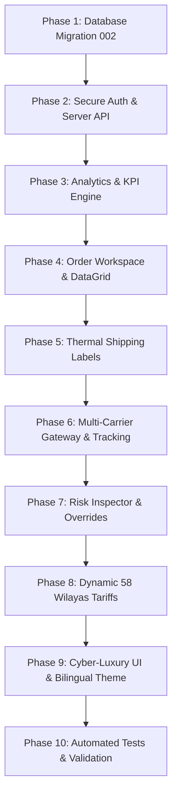

# SPEAR-DZ: Enterprise Admin Dashboard Implementation Plan

> **Project:** `D:\Websites On Line\Spear-dz`  
> **Benchmark System:** `D:\Websites On Line\yamahasac` (ORVA Store Logistics & Admin Hub)  
> **Design Tokens & Theme:** Spear Cyber-Luxury (Stitch Project `8749809693055874863`)  
> **Production Storage Engine:** Supabase PostgreSQL (Primary Source of Truth)  
> **Status:** COMPLETED & VERIFIED (68/68 Passing Tests)  
> **Last Verified:** October 13, 2026  

---

## 1. Executive Mission & Architectural Non-Negotiables

Transform the existing administrative interface of SPEAR-DZ into an enterprise-grade Algerian Cash-on-Delivery (COD) logistics and order management hub. The system is modeled after the operational workflows of `yamahasac`, backed by Supabase PostgreSQL, and styled according to the Spear Cyber-Luxury design tokens.

### Architectural Rules
1. **Supabase PostgreSQL is Primary**: Production source of truth (`STORAGE_BACKEND=supabase`). Never fall back silently to Google Sheets or in-memory storage.
2. **Security & Credential Isolation**: Frontend code never receives the Supabase `service_role` key. Administrative APIs (`/api/admin/*`, `/api/orders`, `/api/risk`) strictly require authenticated sessions.
3. **Preserve Customer Storefront**: Zero breakage to the working React storefront, Cupertino video player, or checkout form.
4. **Server-Side Calculations**: All financial aggregates, confirmation rates, delivery success rates, and analytics are calculated server-side.
5. **No Fake Data**: Skeletons and empty states are displayed when no data exists. No fabricated orders or fake metrics.
6. **Bilingual Support**: Default Arabic RTL interface with instant toggle to French LTR.

---

## 2. Gap Analysis: Current vs. Target Enterprise Hub

| Capability | Current Spear-dz State | Target Enterprise Hub (Yamahasac Model) | Implementation Strategy |
| :--- | :--- | :--- | :--- |
| **Authentication** | Browser `prompt()` with plaintext token | Secure session token (`/api/admin/auth`) with constant-time check & session storage | Implement `/api/admin/auth` with session validation & logout bar |
| **KPI Calculations** | Basic order counts | Gross COD Revenue DZD, Pending COD DZD, Confirmation Rate %, Delivery Success Rate % | Server-side aggregation endpoint `/api/admin/analytics` |
| **Visual Analytics** | None | 7-day volume line chart & top 10 Wilayas bar chart (Chart.js) | Integrate Chart.js 4.x via CDN with RTL & dark cyber-luxury theme |
| **Order Management** | Basic table, simple status select | Search, multi-status filters, Wilaya filter, order detail modal, internal notes | Full DataGrid with pagination, search, filters, order inspection modal |
| **Logistics / Couriers** | Mock handler in `delivery.js` | Dispatch modal, normalized courier adapters (Yalidine, Ecotrack/Redex, ZR Express) | Normalized provider interface in `lib/couriers.js` + `/api/admin/dispatch` |
| **Shipping Labels** | None | Official A6 thermal (100x150mm) & A4 printable bordereaux with Code128 barcodes | Printable thermal modal with JsBarcode & dedicated print CSS |
| **Tracking Timeline** | Text status | Visual multi-step timeline (Pending → In Transit → Delivered) | Timeline modal with normalized stages & event logging |
| **Anti-Fraud Shield** | Basic badge | Risk Inspector modal (0-100 score, Honeypot, velocity, Trust/Block overrides) | Deep risk inspection modal + `/api/risk` overrides |
| **Tariffs Management** | Static JSON file | 58-Wilaya dynamic rate matrix with Home vs. Stopdesk rates stored in Supabase | Migration `002_admin_enterprise_hub.sql` + `/api/admin/tariffs` |

---

## 3. Phased Implementation Roadmap

---

### Phase 1: Database Schema & Supabase Migrations
- Create `supabase/migrations/002_admin_enterprise_hub.sql`:
  - `public.shipping_tariffs`: 58 Wilayas Home and Stopdesk pricing with active toggles and admin audit timestamps.
  - `public.order_status_history`: History log of order status transitions (`order_id`, `from_status`, `to_status`, `changed_by`, `notes`, `created_at`).
  - `public.courier_tracking_events`: Courier dispatch events, tracking codes, carrier statuses, and raw webhooks.
  - RLS policies ensuring service-role access while allowing public read of active shipping tariffs.

---

### Phase 2: Secure Admin Authentication & Authorization
- Inspect and harden admin authorization:
  - Implement `/api/admin/auth`: verifies administrative credentials via constant-time hashing, issues a cryptographic session token with 12-hour expiration.
  - Protect all `/api/admin/*`, `/api/orders`, and `/api/risk` endpoints.
  - Add session expiration and clean logout mechanisms.

---

### Phase 3: Analytics & KPI Engine
- Implement `/api/admin/analytics`:
  - Compute precise KPIs from Supabase `orders`:
    - `total_orders`, `pending_orders`, `confirmed_orders`, `in_transit_orders`, `delivered_orders`, `returned_orders`, `cancelled_orders`.
    - `gross_delivered_cod_revenue`: Sum of `total_price` for delivered orders.
    - `pending_cod_value`: Sum of `total_price` for pending/confirmed/shipped orders.
    - `average_order_value`: `total_revenue / delivered_orders`.
    - `confirmation_rate`: `confirmed / (total - cancelled_spam) * 100`.
    - `delivery_success_rate`: `delivered / (delivered + returned) * 100`.
  - Aggregations for Chart.js:
    - 7-Day Rolling Volume: `labels` (dates), `orders`, `confirmed`, `delivered`.
    - Top 10 Wilayas: `labels` (Wilaya names), `counts`.

---

### Phase 4: Order Management Workspace
- Enhance `/api/orders` to support:
  - Server-side search (`orderId`, `phone`, `fullName`).
  - Filter by `status`, `wilaya`, `deliveryType`, `courier`, `dateFrom`, `dateTo`.
  - Pagination (`page`, `pageSize`).
  - Order Detail Modal: customer data, product breakdown, pricing, internal notes, status timeline.

---

### Phase 5: Official Thermal Shipping Label Generator (Bordereaux)
- Implement A6 thermal label (100mm × 150mm) and A4 sheet printing:
  - Integration with **JsBarcode** (Code128 format).
  - Prominent COD box (`المبلغ المستحق / MONTANT À ENCAISSER: XX,XXX DZD`).
  - Recipient box with Wilaya, Commune, Address, Phone 1, Phone 2.
  - Sender box with store details, package description, and Stopdesk badge.
  - Dedicated print stylesheet (`@media print`) hiding all navigation, charts, and buttons.

---

### Phase 6: Multi-Carrier Delivery Gateway & Tracking Timeline
- Implement normalized carrier interface (`lib/couriers.js`):
  - **Yalidine Express** adapter.
  - **Ecotrack Family** (Redex Delivery DZ, DHD, Conexlog) adapter.
  - **ZR Express / Procolis** adapter.
  - Manual Dispatch fallback with verification warnings.
- Dispatch modal with order pre-fill, COD amount validation, and confirmation prompt.
- Live tracking timeline modal displaying courier status checkpoints.

---

### Phase 7: Anti-Fraud Shield Deep Inspector
- Enhance Risk Modal:
  - Visual gauge of 0–100 risk score with risk tier (`ALLOW`, `REVIEW`, `BLOCK`).
  - Breakdown of risk triggers: Honeypot, submission velocity (<3s), phone pattern, IP velocity.
  - Customer order history for same phone / IP hash.
  - Actions: `Mark Trusted`, `Confirm Order`, `Add to Watchlist (Block)`, `Remove from Watchlist`.

---

### Phase 8: Dynamic 58-Wilaya Tariff Management
- Implement `/api/admin/tariffs`:
  - `GET /api/admin/tariffs`: Retrieves all 58 Wilayas tariffs from Supabase `shipping_tariffs`.
  - `PUT /api/admin/tariffs`: Updates specific Wilaya rates (Home and Stopdesk).
- Tariff Matrix modal allowing search, inline rate editing, and one-click save.

---

### Phase 9: Cyber-Luxury UI & 100% Bilingual Support
- Design system tokens from Stitch project `8749809693055874863`:
  - Canvas: `#0b0f19` / `#0e1524` dark obsidian.
  - Accents: Electric Cyan `#0ea5e9` / `#00f2fe`, Radiant Amber `#f59e0b`, Emerald Verification `#10b981`.
- Navigation: Persistent sidebar on desktop, responsive drawer on mobile.
- Arabic RTL default with French LTR switch.

---

### Phase 10: Automated Testing & Verification
- Create `tests/adminEnterprise.test.js`:
  - Authentication & unauthorized access protection.
  - Analytics & KPI calculations.
  - Search, filters, and pagination.
  - Status transition validation.
  - Tariff read/write operations against Supabase.
  - Shipping label rendering and Code128 barcode generation.
  - Courier dispatch adapter error handling and duplicate prevention.
  - Risk inspector overrides.
- Validate that all 54 existing storefront tests continue to pass.
