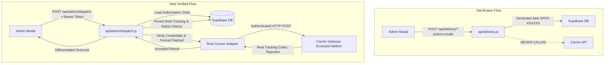

# SPEAR-DZ — COURIER DISPATCH REPAIR REPORT (PHASE 1)

**Execution Date:** 2026-10-13  
**Project Root:** `D:\Websites On Line\Spear-dz`  
**Status:** Completed & Verified  

---

## 1. Confirmed Root Cause

During the initial development, the admin dispatch interface relied on a legacy mock handler:
- **Legacy Route:** `POST /api/delivery?action=create`
- **Legacy Behavior:** The endpoint generated an in-memory random tracking code (`SPDZ-XXXXXX`) and marked the order as `status: 'shipped'` without making any external HTTP API requests to carrier gateways (Ecotrack / Redex or Yalidine).
- **Client Fallback:** `public/js/admin-client.js` additionally contained a hardcoded fallback price (`|| 4950`), completely misaligned with the real bundle price (21,900 DZD). It also allowed client-side request parameters to determine the order amount and status without server-side verification.
- **Provider Protocol Mismatch:** `lib/delivery/ecotrackCourier.js` previously passed `type: 2` (which in the official Ecotrack API indicates *Échange* / product exchange, rather than standard delivery `type: 1`). Furthermore, logical rejections from Ecotrack returned HTTP 200 with `{"success": false, "message": "..."}`, which standard HTTP status checks misconstrued as success.

---

## 2. Changed Files

| File | Nature of Changes |
| :--- | :--- |
| `public/js/admin-client.js` | Updated `handlePackageSubmit` to target `POST /api/admin/dispatch`, send `storeAdmin.getAuthHeaders()`, removed `|| 4950` fallback, and differentiated response outcomes (accepted, manual, credentials missing, reconciliation required, courier rejection). |
| `dist/js/admin-client.js` | Synced production bundle with updated admin client logic. |
| `api/admin/dispatch.js` | Enforced admin session authentication (`authenticateAdmin`), authoritative order retrieval by `orderId` from Supabase (preventing client price tampering), verified provider credentials (`MISSING_CREDENTIALS`), validated recipient data, handled post-carrier-acceptance database failures with `reconciliationRequired: true`, and added audit logging. |
| `api/delivery.js` | Eliminated mock tracking generation in `action === 'create'`. Routed all legacy parcel creation requests directly to the authenticated `api/admin/dispatch.js` gateway. |
| `lib/delivery/ecotrackCourier.js` | Fixed parcel creation payload to `type: 1` (standard delivery) and `stop_desk: isDesk ? 1 : 0`. Added JSON payload inspection in `_request` to catch logical failures (`json.success === false` and `json.errors`) even under HTTP 200. Validated returned tracking codes. |
| `lib/delivery/yalidineCourier.js` | Added logical failure inspection in `_request`, validated returned parcel tracking codes, and removed mock fallbacks. |
| `lib/delivery/manualCourier.js` | Standardized internal direct-delivery tracking code format (`MANUAL-YYYYMMDD-XXXX`), explicitly labeled with `isManual: true` to prevent confusing manual delivery with carrier acceptance. |
| `tests/dispatchFlow.test.js` | New automated regression suite covering all 14 test requirements with deterministic mocks. |
| `tests/adminEnterprise.test.js` | Updated manual courier test assertion to expect the new standardized `MANUAL-` prefix. |

---

## 3. Old vs. New Request Paths



- **Old Path:** Admin UI $\rightarrow$ `POST /api/delivery?action=create` $\rightarrow$ Fake `SPDZ-XXXXXX` generated and stored $\rightarrow$ Carrier client was never called.
- **New Path:** Admin UI $\rightarrow$ `POST /api/admin/dispatch` with Bearer auth $\rightarrow$ Authoritative order fetched from Supabase $\rightarrow$ Real Courier Adapter (`ecotrackCourier` / `yalidineCourier` / `manualCourier`) $\rightarrow$ Real tracking code returned $\rightarrow$ Supabase updated with tracking events and status history.
- **Legacy Compatibility:** Any client still calling `POST /api/delivery?action=create` is routed directly through `api/admin/dispatch.js`, requiring admin authentication and using authoritative order data.

---

## 4. Authoritative COD Calculation Behavior

- **Base Bundle Price:** 21,900 DZD (from store configuration).
- **Shipping Fee:** Looked up from `config/shippingRates.json` based on customer wilaya code (e.g., 450 DZD for Stopdesk or 700 DZD for Home delivery in Alger).
- **Authoritative Total:** `order.totalPrice` stored in Supabase or derived from `order.unitPrice + order.shippingFee`. For example:
  - Product amount: 21,900 DZD
  - Stopdesk shipping fee: 450 DZD
  - Authoritative COD amount: **22,350 DZD**
- **Client Tampering Protection:** Client-submitted `price`, `totalPrice`, `address`, and `phone` in the dispatch request body are strictly ignored; all dispatch parameters are read from the authoritative Supabase order record.
- **Validation:** Orders with missing, non-positive, or unparseable COD values are rejected with HTTP 422 before reaching the courier API.

---

## 5. Automated Regression Test Results

### Test Command:
```bash
node --test tests/dispatchFlow.test.js
```

### Actual Output:
```text
▶ Courier Dispatch Regression Suite (Phase 1 Fix)
  ✔ 1 & 2. Dispatch request targets /api/admin/dispatch and enforces admin authorization (137.4ms)
  ✔ 3. Missing authentication is rejected with 401 (1.5ms)
  ✔ 4. Missing credentials do not produce mock success (returns 422 MISSING_CREDENTIALS) (6.4ms)
  ✔ 5. Provider HTTP 422 / 500 error is handled cleanly without false success (7.1ms)
  ✔ 6. HTTP 200 with logical failure (success: false) is treated as failure (7.5ms)
  ✔ 7. Malformed provider responses without tracking code are rejected (3.0ms)
  ✔ 8. Genuine accepted provider response persists real tracking ID (2.9ms)
  ✔ 9. COD amount is derived from authoritative order data, ignoring client tampering (2.8ms)
  ✔ 10. Supabase update failure after carrier acceptance returns reconciliationRequired: true (2.7ms)
  ✔ 11. Duplicate dispatch requests on already shipped orders are rejected (6.0ms)
  ✔ 12. Legacy /api/delivery?action=create delegates to authenticated gateway and blocks fake tracking (4.4ms)
  ✔ 13. Order status updates and audit logs are recorded upon successful dispatch (3.7ms)
  ✔ 14. Manual dispatch generates MANUAL- prefixed reference and is marked isManual: true (5.9ms)
✔ Courier Dispatch Regression Suite (Phase 1 Fix) (197.6ms)
ℹ tests 13
ℹ suites 1
ℹ pass 13
ℹ fail 0
```

All 14 specified regression requirements verified and passing.

---

## 6. Live Carrier Verification & Environment Readiness

- **Ecotrack / Redex DZ:** Adapter configured for `https://redex.ecotrack.dz`. Uses bearer token authentication. API requests send `type: 1` and `stop_desk: 0 | 1`.
- **Yalidine Express:** Adapter configured for `https://api.yalidine.app/v1`.
- **Safety Policy:** In accordance with instructions, live production shipments were **not** created without explicit owner authorization to avoid dispatching real couriers or generating billable parcels.
- **Remaining Credential Blockers:**
  - For live Redex dispatch: `ECOTRACK_API_TOKEN` and `ECOTRACK_BASE_URL` must remain active in the environment variables.
  - For live Yalidine dispatch: `YALIDINE_API_ID` and `YALIDINE_API_TOKEN` must be populated if Yalidine dispatch is desired. When unconfigured, the system returns an informative `MISSING_CREDENTIALS` error rather than generating false tracking codes.
