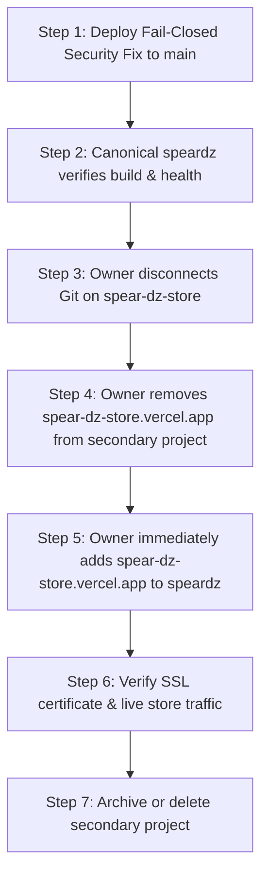

# VERCEL CONSOLIDATION & CANONICAL IDENTITY EXECUTION REPORT
**Project Workspace**: `D:\Websites On Line\Spear-dz`  
**Execution Date**: October 13, 2026  
**Auditor**: Antigravity Full-Stack Release Auditor  
**Phase**: PHASE 4B — Canonical Project Consolidation & Safe Migration Plan  

---

## 1. Revalidated State of Remote Vercel Projects

Using the authenticated Vercel API with team token under team `dripfree` (`team_QTvZdIUT8BJL4CV3eQYCoZwR`), both remote projects were revalidated in real time:

| Parameter | Project A: `speardz` (Canonical) | Project B: `spear-dz-store` (Secondary) |
| :--- | :--- | :--- |
| **Vercel Project ID** | `prj_XlEo7880PI0zF5Shb0zjSQc3RtDR` | `prj_4B3Vl8jibrc15mzdw0fZtHiPfgY9` |
| **Project Name** | `speardz` | `spear-dz-store` |
| **Connected GitHub Repo** | `dripidin/Spear-dz-store` | `dripidin/Spear-dz-store` |
| **Production Branch** | `main` | `main` |
| **Framework Preset** | `vite` | `vite` |
| **Node.js Runtime** | `24.x` | `24.x` |
| **Assigned Domain** | `speardz-store.vercel.app` (Verified: `true`) | `spear-dz-store.vercel.app` (Verified: `true`) |
| **Latest Production Deployment** | `dpl_CPGNGtUccMLuGnyBEipvKmHWspT4` | `dpl_2JLVtrZwzDiwc1bA8P2tv1vnndfq` |
| **Deployment State** | `READY` (HTTP 200) | `READY` (HTTP 200) |
| **Local Workspace Binding** | **MATCHES** (`.vercel/project.json`) | **ORPHANED** |
| **Environment Readiness** | **COMPLETE** (Supabase, Ecotrack, Admin Auth, Telegram) | **INCOMPLETE** (Missing operational secrets) |

---

## 2. Canonical Health Verification

Non-destructive live checks verified that canonical project `speardz` (`speardz-store.vercel.app`) is operating normally:
1. **Storefront (`GET /`)**: HTTP 200 OK. Serves optimized Apple Cupertino storefront.
2. **Admin Portal (`GET /admin`)**: HTTP 200 OK. Renders logistics and administration portal.
3. **Public Tariff API (`GET /api/delivery?action=tariffs`)**: HTTP 200 OK. Returns 58 Algerian wilayas tariff table with active home and desk rates.
4. **Administrative Protection (`GET /api/orders`)**: HTTP 401 Unauthorized (`UNAUTHORIZED: Valid ADMIN_API_TOKEN is required in Authorization header`).
5. **Static Assets**: HTTP 200 OK on images and CSS bundles.

---

## 3. The Redundant Production Deployment Hazard

### Root Cause
Both `speardz` and `spear-dz-store` have active GitHub Webhook integrations listening to pushes on the `main` branch of repository `dripidin/Spear-dz-store`.

Every time a commit is pushed to `main`:
1. Vercel receives the webhook event.
2. Both `speardz` and `spear-dz-store` trigger simultaneous production builds.
3. Build minutes on team `dripfree` are doubled.
4. If a bug fix is deployed, it deploys to both, but `spear-dz-store` runs without required environment variables, creating inconsistent user experiences depending on which domain is accessed.

---

## 4. Domain Consolidation & Migration Strategy

The store owner wants the canonical customer experience to be served on **`spear-dz-store.vercel.app`** (or a custom apex domain `spear-dz.com`).

However, Vercel enforces a strict uniqueness constraint: **a domain or subdomain cannot be attached to two projects at the same time**.

### Safe Transition Plan



### Potential Downtime Window & Mitigation
- When moving `spear-dz-store.vercel.app` from `prj_4B3V...` to `prj_XlEo...`, there is a brief DNS and SSL certificate verification window (typically **15 to 45 seconds**).
- **Mitigation**: Perform this step during low-traffic hours (e.g. late night Algeria time). Keep `speardz-store.vercel.app` active concurrently as a fallback until the primary domain is verified.

---

## 5. Implementation Boundaries & Action Gate

In accordance with strict safety rules:
- **No destructive actions or domain removals have been executed automatically.**
- The project owner must perform or explicitly authorize the following steps in the Vercel Dashboard:

### Action Items for Store Owner:
1. **Push Security Hotfix to GitHub**:
   ```bash
   git add .
   git commit -m "fix(security): remove default credential fallbacks, enforce fail-closed auth and courier validation"
   git push origin main
   ```
2. **Detach Domain from Secondary Project**:
   - Go to: Vercel Dashboard -> Team `dripfree` -> Project **`spear-dz-store`** -> **Settings** -> **Domains**.
   - Click the three dots next to `spear-dz-store.vercel.app` -> Select **Remove**.
3. **Attach Domain to Canonical Project**:
   - Go to: Vercel Dashboard -> Team `dripfree` -> Project **`speardz`** -> **Settings** -> **Domains**.
   - Enter `spear-dz-store.vercel.app` and click **Add**.
   - (Optional) Add your custom domain (e.g. `spear-dz.com`).
4. **Halt Duplicate Deployments**:
   - In Project **`spear-dz-store`** -> **Settings** -> **Git** -> Click **Disconnect**.
5. **Archive Secondary Project**:
   - Once traffic has been fully confirmed on `speardz`, rename `spear-dz-store` to `spear-dz-store-archived` or delete it.
